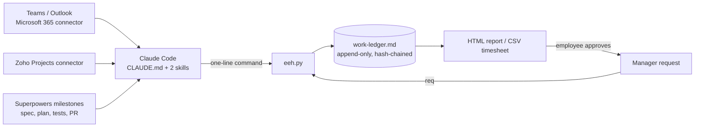
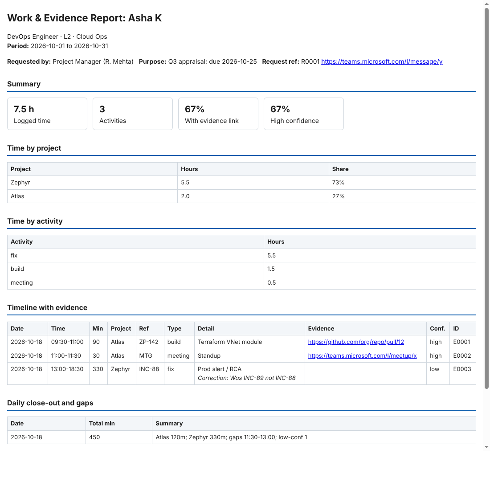

# EEH v2: Claude work-proof kit for IT employees


A consent-based personal work log, time tracker and evidence kit. It tracks **your own** activity only.



## Sample report



## Design decisions

| Decision | Why | Alternative considered |
|---|---|---|
| Markdown ledger, not a database | Readable by anyone, diff-able, no server to run | SQLite: faster queries, but not human-readable |
| SHA-256 hash chain per row | Any edit to a past row is detectable with `verify` | Signed commits / WORM storage: stronger, needs infra |
| Script writes reports, not the model | Deterministic output and near-zero tokens | Model-written reports: flexible, costly, can drift |
| Own data only, consent-based | Legal and ethical; evidence stays admissible | Org-wide monitoring tools (Hubstaff, Teramind) |
| Python stdlib only | Runs on any Windows/Linux box with no installs | Click/Rich: nicer CLI, extra dependencies |
| CI on Windows and Linux | Proves it works where employees actually run it | Linux only: misses path/encoding issues |

## What's in the kit

| File | Job | Loaded into context |
|---|---|---|
| `CLAUDE.md` | Profile, rules, token budget, Superpowers bridge, shortcuts | Always (~450 tokens) |
| `.claude/skills/eeh-ledger/SKILL.md` | Start day, log, end day, timesheet | Only when triggered |
| `.claude/skills/eeh-report/SKILL.md` | Proof, manager data requests, appraisal | Only when triggered |
| `eeh.py` | Writes the ledger, hash chain, totals, gaps, HTML report, CSV timesheet | Never (runs outside the model) |
| `work-ledger.md` | **The single file holding all your data** (created by `init`) | Only the slices you ask for |
| `request-template.md` | Form a PM/lead/HR sends you to request data | No |
| `examples/` | Sample ledger and a sample appraisal report (fictional data) | No |
| `tests/`, `.github/workflows/ci.yml` | Unit tests run on Windows and Linux on every push | No |

Why: Claude Code is used rather than claude.ai chat because a ledger file needs a real folder, and Superpowers only runs in Claude Code.

## How the pieces fit

1. **Doing the work:** Superpowers (technical roles) gives Claude a disciplined method: brainstorm, plan, test-first, verify, review.
2. **Proving the work:** each Superpowers milestone adds one ledger row with its artefact (spec, plan, test output, PR). Teams/Outlook/Zoho add meeting, message and task evidence at end of day.
3. **Sharing the proof:** a manager sends the request form, you run `req`, and `eeh.py` generates the report and logs that you shared it, along with the report's hash.

## Token plan

| Saving | How |
|---|---|
| Always-on prompt 73% smaller | v1 prompt was 1,209 words; `CLAUDE.md` is 328. The details live in skills, which load only when you use them |
| 3 skills merged into 2 | Fewer skill descriptions in every session |
| No model-written tables | `eeh.py` does the maths, hashing and HTML. Claude writes a one-line command |
| No whole-ledger reads | `eeh.py show --from --to` returns only the rows needed |
| One connector pass a day | At end day only: today's items, your own, max 25 |
| Fresh session daily | The ledger holds the memory, so long chats don't keep getting re-read |
| Cheaper model for logging | `/model sonnet` or `haiku` for `l:` and `ed` |
| Superpowers kept lean | `executing-plans` over `subagent-driven-development`; skip brainstorming under 30 min |

Advanced option: a scheduled end-of-day routine that runs `ed` automatically.

## Superpowers by role

| Role | Install? | Most useful Superpowers skills |
|---|---|---|
| Developer, DevOps, Cloud, SRE | Yes | writing-plans, test-driven-development, systematic-debugging, verification-before-completion, finishing-a-development-branch |
| QA / Automation | Yes | test-driven-development, systematic-debugging, requesting-code-review |
| L1/L2 Support | Optional | systematic-debugging |
| Lead, PM, Manager, Architect | Optional | brainstorming, writing-plans (they work for non-code plans too) |

Superpowers costs about 800 tokens per session for its always-on `using-superpowers` instructions. Other skills load on demand. Source: github.com/obra/superpowers (MIT).

## Setup (Windows 11, PowerShell)

1. **Install Python and Git.**
   ```powershell
   winget install -e --id Python.Python.3.12
   winget install -e --id Git.Git
   ```
   Close and reopen PowerShell, then run `python --version`.
   Expected result: `Python 3.12.x`.
   Fix: if `python` opens the Microsoft Store, go to Settings > Apps > Advanced app settings > App execution aliases and turn off both Python aliases.

2. **Install Claude Code.** This needs a paid Claude plan (Pro or above). If you already have one, it costs nothing extra.
   ```powershell
   irm https://claude.ai/install.ps1 | iex
   ```
   Expected result: `claude --version` prints a version. You can also use the Code tab in the Claude desktop app.

3. **Create the ledger folder in your company OneDrive and copy the kit into it.**
   ```powershell
   mkdir "$env:OneDrive\EEH"
   cd "$env:OneDrive\EEH"
   ```
   Copy `CLAUDE.md`, `eeh.py`, `request-template.md` and the `.claude` folder into it.
   Expected result: `dir -Force` lists all four.
   Why: company OneDrive keeps the evidence inside approved storage and gives it file version history.

4. **Create your ledger.**
   ```powershell
   python eeh.py init --name "Your Name" --designation "DevOps Engineer" --level L2 --team "Cloud Ops" --hours 09:30-18:30
   ```
   Expected result: `Created work-ledger.md`.

5. **Fill the Profile line** at the top of `CLAUDE.md` (replace each `{{…}}`).

6. **Connect Microsoft 365 (Teams, Outlook) and Zoho Projects** at claude.ai > Settings > Connectors. Then run `claude` in the folder and type `/mcp`.
   Expected result: both connectors are listed.
   Fix: if your company blocks Microsoft 365, ask IT to approve the Claude app in Entra ID. Until then, paste links in by hand; those rows are marked `manual`.

7. **Optional, for technical roles: install Superpowers.** Inside `claude`:
   ```
   /plugin install superpowers@claude-plugins-official
   ```
   Expected result: `/plugin` lists superpowers as enabled.

8. **Test drive.** Inside `claude`, type: `sd`, then `l: standup 10:00-10:15 MTG <teams link>`, then `ed`.
   Expected result: a one-line `E0001 …` confirmation, then a close summary with totals, gaps and a seal hash.

## For managers: requesting data

Send the employee the block in `request-template.md`. The employee types `req <who> <from..to> <purpose>`. The employee then gets an HTML report to review and send you. The report includes hours, a timeline with evidence links, gaps, and an integrity check. The request and the share are both recorded in their ledger.

## Teardown

1. Inside `claude`: `/plugin uninstall superpowers`.
2. claude.ai > Settings > Connectors: disconnect Microsoft 365 and Zoho Projects.
3. Delete `CLAUDE.md`, `eeh.py` and `.claude` from the folder. Keep or delete `work-ledger.md` and reports according to company retention policy.
4. Optional: `winget uninstall Python.Python.3.12`.
